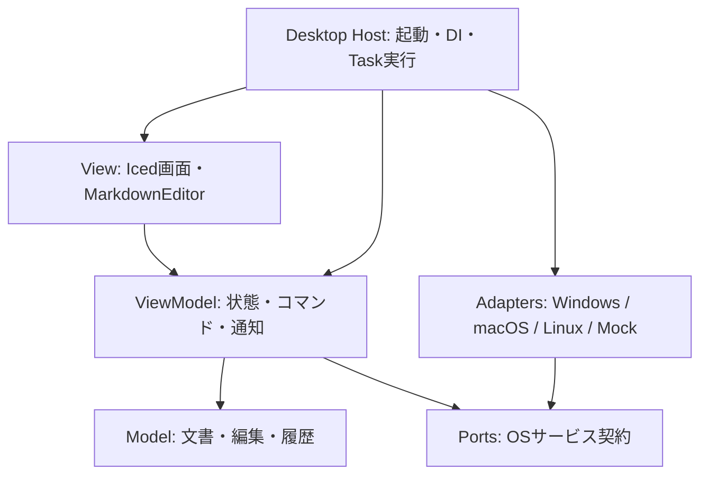

# norito 設計

作成日: 2026-10-12  
状態: 目標設計。基本構文のWYSIWYG直接編集とソース切り替えを実装済み。日本語IME・各OSの実機検証は継続する。

実装状況は [README](../README.md) を参照。以下のMVP要件をすべて実装した状態ではない。現段階のI/Oポートは同期traitとして定義し、Hostのblocking workerで実行する。ディレクトリ列挙のページング、外部変更監視は後続とする。

現在の編集面はModelの `Projection` が保持する原文・表示範囲の対応を使い、単一のIced TextEditor上で直接編集する。汎用HighlighterとIcedへの可変文字サイズ・選択座標のパッチを組み合わせ、本文と見出しで独立した入力欄を作らない。未編集箇所を含めた文書全体の再シリアライズは行わない。

画面は本文を中心にし、通常操作を「ファイル・書式・表示」のメニューとショートカットへ集約する。サイドバーは非表示にできる。常設の書式・保存ツールバー、ブランドの説明文、装飾的なキャッチコピー、起動時のサンプル文章は置かない。

カラーテーマは提供された加賀棒茶のデザイン資料を基に、暗色を既定、明色を切り替え可能として実装する。色のトークンはdesktop側に保持し、汎用Iced拡張へアプリ固有の配色を持ち込まない。

## 1. 目的とスコープ

Rustで、整形された文章をその場で編集できるデスクトップ向けMarkdownエディタを構築する。アプリケーションはMVVMを基本とし、ファイルアクセスやダイアログなどのOS依存処理を差し替え可能にする。

初期対象はWindows、macOS、Linux。開発環境に合わせてWindowsで最初の縦断実装を行い、各OSの実機検証へ進む。

MVPでは次を提供する。

- 単一文書の新規作成、開く、保存、名前を付けて保存。
- ディレクトリを開き、サイドバーのファイルツリーからMarkdown文書を切り替える。
- 見出し、段落、太字、斜体、リンク、引用、箇条書き、番号付きリスト、インラインコード、コードブロックの直接編集。
- Markdown記法の入力による表示更新と、選択範囲への書式操作。
- 複数ブロックにまたがる選択、コピー、切り取り、貼り付け、Undo / Redo。
- 日本語IME、キーボード操作、未保存状態表示、終了時確認。
- 同じ文書を操作するソース表示への切り替え。
- 外部変更の検知と保存競合の通知。

表、タスクリスト、画像挿入UI、数式、脚注、PDF出力、複数タブ、複数ルート、ファイル・ディレクトリの改名／移動／削除、全文検索、同期、プラグインは後続段階とする。未対応構文を開いても原文は保持し、該当範囲をソースとして編集できるようにする。

### ディレクトリを開く体験

「フォルダを開く」で単一のルートを選択し、サイドバーにディレクトリと `.md` / `.markdown` ファイルを表示する。拡張子判定は大文字小文字を区別しない。単体ファイルを開く操作も引き続き提供する。

- 子ディレクトリは展開時に非同期で列挙する。初回に全階層を走査せず、本文も選択時に読み込む。
- 隠し項目はOSアダプターで判定してMVPでは非表示にする。ディレクトリへのシンボリックリンクやジャンクションは辿らず、ツリーの循環を避ける。
- 編集中の文書は常に1つとする。別文書への切り替えでは未保存確認を行い、読み込みに成功してから文書とツリーの選択表示を置き換える。失敗・キャンセル時は現在の文書を保持する。
- フォルダを開く・変更する・閉じる操作はツリーだけを変更し、編集中の文書を閉じない。ルート外の文書も編集でき、その場合はツリーの選択を空にする。
- フォルダ変更は新しいルートの列挙に成功してから確定し、失敗・キャンセル時は元のツリーを維持する。空フォルダ、読み込み中、権限エラーを区別して表示する。
- MVPのツリー更新は明示的な「更新」で行う。保存成功時には該当する読み込み済みの親ディレクトリも再列挙する。ツリー全体の自動監視は後続とし、編集中ファイルの外部変更監視とは分離する。
- 新規文書の保存ダイアログは、選択したディレクトリまたはルートを初期位置にする。Ctrl+Nまたはツリーの＋で名前を入力し、Enterで選択ディレクトリ内に作成する。.mdは補完し、既存ファイルは上書きしない。Escapeでキャンセルする。

## 2. 技術選定

| 領域 | 方針 | 理由・条件 |
| --- | --- | --- |
| 言語 | Rust | UI、編集モデル、OSアダプターを共通言語で構成する |
| GUI | Iced 0.14系を初期候補とする | 状態・メッセージ・更新・描画を分離できる。採用バージョンは試作時に固定する |
| 編集UI | 独自の `MarkdownEditor` ウィジェット | 描画位置と原文の対応、選択、IME、書式付き直接編集を制御する |
| Markdown解析 | pulldown-cmark | イベントと原文範囲を取得し、表示用の構造を生成する |
| テキスト保持 | 当初はUTF-8文字列、計測後にrope等を検討 | 保存時の原文保持を優先し、早期の複雑化を避ける |
| 非同期実行 | Iced側のTaskとI/Oワーカー | ドメインにGUIや特定の実行基盤を持ち込まない |
| OS連携 | Rust traitとOS別アダプター | ファイル、ダイアログ、監視などを個別に差し替える |

Icedの標準 `text_editor` は複数行テキスト入力、`markdown` はMarkdown表示のための部品であり、組み合わせるだけで今回の編集体験が完成するとは想定しない。標準エディタはソース表示の候補とし、本文編集の技術検証を先行する。

WebViewベースのTauriも候補となるが、今回はRust中心のUI実装を優先する。専用ウィジェットでIME・選択・アクセシビリティの必要水準を満たせない場合は、GUI選定を再評価する。その場合もModel、ViewModel、OSポートは維持する。

## 3. MVVMと依存方向



矢印はコード上の依存を表す。ViewModelは具象アダプターを参照せず、ポートの要求・結果型を扱う。Hostが要求を実行して結果をViewModelへ返す。

### Model

`Document`、Markdown解析結果、編集トランザクション、選択範囲、履歴を保持する。Iced型、OS API、ファイルダイアログを参照しない。ファイル内容からの文書生成と文書からの保存用スナップショット作成は純粋な処理とする。

### ViewModel

`EditorViewModel` が文書セッション、表示モード、保存状態、エラー、確認待ち状態を管理する。公開APIの基本形は `dispatch(Command) -> Vec<Effect>` とし、非同期結果もコマンドとして受け取る。

`WorkspaceViewModel` がルートの `DirectoryHandle`、ツリーノード、展開状態、列挙状態、選択中ファイルを管理する。文書を開く要求は共通の遷移処理を通して `EditorViewModel` へ渡し、未保存確認を迂回しない。列挙結果にはworkspace世代と要求IDを持たせ、フォルダ変更後の古い結果や更新前の遅延結果を破棄する。

`ViewState` はタイトル、未保存表示、実行可能な操作、表示用文書スナップショットなどを公開する。大きな本文を毎回複製せず、共有スナップショットとrevisionを利用する。

Icedの `update` はメッセージをViewModelのコマンドへ変換し、返されたEffectをTaskへ変換する。MVVMの責務分離にIcedの更新方式を適用し、双方向バインディングは必須にしない。

### View

メニュー、ツールバー、ファイルツリー、ステータス、編集領域、確認UIを描画する。入力を意味のあるコマンドに変換し、ファイルI/Oや保存可否の判断は行わない。フォーカス、ホバー、レイアウトキャッシュ、IMEの未確定表示など描画固有の状態だけを持つ。

### Iced独自拡張の分割

Icedを独自拡張することを前提に、次の単位で分離する。まず公開APIによる拡張を実装し、本体への変更が必要な場合は別のパッチとして管理する。

| 配置 | 責務 | 依存の境界 |
| --- | --- | --- |
| `norito-iced-ext` | 汎用のテキストレイアウト補助、ヒットテスト、IME接続、選択描画、再利用可能なGUI部品 | Icedには依存するが、Markdown、Model、ViewModel、ファイルI/Oには依存しない |
| `norito-editor-widget` | `MarkdownEditor`、表示投影とレイアウトの対応、編集入力イベント、Markdown固有の描画 | Iced、iced-ext、Modelの公開型に依存する。ViewModelやOSサービスには依存しない |
| `apps/desktop` | 画面構成、アプリのテーマ、ウィジェットイベントとViewModelコマンドの接続、Effectの実行 | 汎用部品を組み合わせ、アプリ固有の動作を決める |
| `vendor/iced_*` | 公開APIでは対応できないIced本体・ランタイム・描画バックエンドの変更 | アプリ固有のMarkdown処理や保存処理を持ち込まない |

`norito-iced-ext` は必要になった拡張から切り出す。Icedの全APIを独自のtraitで包む抽象化は作らず、バージョン依存の処理は内部の `compat` モジュールに集約する。Icedの型を使える範囲はGUIクレートとdesktopに限定し、Model・ViewModel・OSポートの公開APIには含めない。

`norito-editor-widget` の入力は読み取り用の文書スナップショット、選択状態、表示設定とする。出力は `EditorEvent`（入力確定、選択変更、書式操作要求等）としてdesktopへ返す。文書変更はViewModelを経由してModelへ適用し、ウィジェット内に別の本文・Undo履歴を正本として持たない。描画上の位置を原文位置へ変換したイベントにはrevisionを付け、古いレイアウトに基づく編集を誤適用しない。

Modelの `ProjectionMap` は原文と論理的な表示内容の対応を管理する。フォント、ピクセル座標、折り返し、ヒットテストのキャッシュはGUI側で管理し、純粋な編集規則と描画エンジンを分離する。IMEのOSイベントと候補位置の接続はGUI側で扱い、ファイル等のOSサービスポートとは別の責務とする。

Iced本体への変更は `vendor/iced_core`、`vendor/iced_graphics`、`vendor/iced_widget` に分け、基準revisionと変更内容を `vendor/README.md` に記録する。workspaceルートのCargo patchで依存先を統一する。変更理由、影響するOS、再現手順、上流への提案状況を記録する。互換なIced関連クレート一式を揃え、独自版と上流版の型が混在しないことを確認する。上流更新時は拡張部品の検証と編集ウィジェットのIME・選択・描画検証を先に行う。

## 4. Markdown編集モデル

### 4.1 原文を唯一の正本にする

文書はMarkdown原文を保持し、解析木と表示用ブロックは派生データとする。AST全体をMarkdownへ再出力する保存方式は採用しない。これにより、編集していない範囲の空白、記法、未対応構文を不用意に書き換えない。

```text
Document
  id: DocumentId
  revision: Revision
  source: MarkdownText
  parsed: ParsedDocument       // sourceから再生成可能
  history: EditHistory

DocumentSession
  document: Document
  file: Option<FileHandle>     // パスはOS側で管理
  disk_version: Option<FileVersion>
  saved_snapshot: ContentFingerprint
  encoding: UTF-8 with/without BOM
  newline_policy: PreserveExisting
```

MVPで読み込む文字コードはUTF-8とUTF-8 BOM付きに限定する。不正なUTF-8は黙って置換せずエラーとする。既存のCRLF/LFは保持し、新規行には文書の優勢な改行コードを使う。無編集での保存はBOMを含むバイト一致を目標とする。

### 4.2 編集トランザクション

挿入、削除、貼り付け、書式変更を `EditTransaction` に統一する。トランザクションは適用前revision、原文範囲への置換群、適用前後の選択を持つ。複数置換は範囲の重複を検査して末尾から適用し、Undoでは逆操作で原文を復元する。

太字コマンドは選択範囲に必要な記号を挿入・除去する。ブロックをまたぐ選択、コード内、既存の強調との重なりは構文を確認して処理し、対応外なら操作を無効にする。編集範囲内では表記を調整する場合があるが、文書全体の正規化は行わない。

連続入力は履歴上でまとめ、IME確定、貼り付け、書式操作、カーソル移動でグループを区切る。WYSIWYGとソース表示は共通の履歴を使い、ウィジェット側の独立したUndo履歴を正本にしない。

### 4.3 表示位置と原文位置

解析器の範囲情報だけでは、隠れた記号やエスケープ、文字参照の編集位置を完全には扱えない。`ProjectionMap` を用意し、原文範囲と表示テキスト・表示オブジェクトの対応を保持する。解析結果に加えて原文の字句情報も参照する。

- 原文範囲はUTF-8バイトオフセットで統一し、文字境界を検証する。
- カーソル移動・削除は書記素クラスタ単位とし、絵文字や結合文字を壊さない。
- 行折り返しや双方向テキストのヒットテストはレイアウト結果を利用する。
- 曖昧な境界では前後のどちらに属するかを示すaffinityを持つ。
- 非アクティブ範囲では記号を隠して整形表示する。必要な記号はカーソル付近で編集可能にし、切り替え時は原文アンカーで選択を維持する。
- 未対応構文は原文ブロックとして表示し、内容を失わない。

本文は文書全体の選択を管理する単一の編集サーフェスとする。段落ごとに独立した入力欄を並べる構成は、ブロック間の選択やIMEの整合性を損なうため避ける。

### 4.4 IMEと解析

IMEの未確定文字列は一時的なcompositionとして扱い、確定時に1トランザクションへ変換する。変換中は対象ブロックの表示構造を安定させ、再解析によるカーソルジャンプを防ぐ。候補ウィンドウ位置は描画上のキャレット位置をOSへ通知する。

初期実装は全体解析でもよいが、結果にrevisionを付けて古い結果を破棄する。後に変更ブロックと周辺へ解析を絞る際も、コードフェンスや参照リンクなど離れた範囲に影響する構文を考慮する。

## 5. OSサービスの差し替え

ポートは `norito-platform` に定義する。ModelとViewModelに `cfg(target_os)` を置かず、起動時のcomposition rootで実装を選択する。OSが同じでも、テストや将来の保存先に合わせてサービスを差し替えられる。

用語は以下で統一する。

- **Port**: `FileStore` などのRust traitと、要求・結果・エラーの型で表す契約。
- **Adapter**: そのtraitを実装する `WindowsFileStore` や `MemoryFileStore` などの具象型。
- **Composition root**: 起動時に具象Adapterを生成し、Hostのサービス集合へ注入する場所。

したがって「Adapterをtrait経由で差し替える」構成となる。I/Oワーカーで共有する `FileStore` は例えば `Arc<dyn FileStore>` としてHostが保持する。ViewModelはEffectを返すため、Adapterやサービス集合を直接保持しない。GUIスレッド制約のあるダイアログ等はHostが適切なスレッドへ配送し、全ポートに一律の `Send + Sync` 制約を課さない。

| ポート | 主な操作 | 契約 |
| --- | --- | --- |
| `FileStore` | read / write / metadata | バイト列を扱い、競合・権限・容量不足などを型付きエラーで返す |
| `DirectoryStore` | list_children / create_file / create_directory | 直下の項目を列挙し、opaqueなハンドル、表示名、種別、隠し属性を返す。リンク先を再帰走査しない |
| `FileDialog` | choose_open / choose_save / choose_directory | キャンセルは正常な結果として扱う。保存時は初期ディレクトリを指定可能にする |
| `FileWatcher` | watch / unwatch | 通知は再検査のきっかけとし、通知だけで変更を断定しない |
| `Clipboard` | read / write | MVPはプレーンテキストのMarkdownを扱う |
| `AppPaths` | config_dir / recovery_dir | OS標準の保存場所を提供する |
| `ExternalOpener` | open_link | 許可したスキームだけを開く |

API契約の概略（型名は設計上の名称で、以下はコンパイル対象ではない）:

```rust
trait FileStore: Send + Sync {
    fn read(&self, file: FileHandle) -> IoFuture<ReadResult>;
    fn write(&self, request: WriteRequest) -> IoFuture<WriteResult>;
}

struct WriteRequest {
    file: FileHandle,
    bytes: SharedBytes,
    expected_version: ExpectedVersion, // MustNotExist / Match(version)
}
```

`IoFuture<T>` はSendなboxed futureで `Result<T, PlatformError>` を返すものとする。生の `PathBuf` はアダプターが保持し、上位層にはopaqueな `FileHandle` と表示用ファイル名を返す。パスの大文字小文字や文字コードを上位層で独自に正規化しない。

ディレクトリも同様に `DirectoryHandle` で参照し、ファイルとディレクトリの同一性は表示名ではなくハンドルで判断する。列挙はページ単位で取得可能な契約にして、大量の直下項目でもUIを停止させない。更新時には既存の列挙カーソルを破棄し、ハンドルの有効性とアクセス可否は各操作時に再確認する。

OS別モジュールは `windows` / `macos` / `linux` に分け、共通で十分な処理は `common` に置く。標準ライブラリで解決できる処理を重複実装する必要はない。

## 6. 保存と非同期処理

### 保存フロー

1. ViewModelが本文・revision・文書ID・保存先をスナップショット化する。
2. 保存先未指定ならダイアログを開く。キャンセル時は未保存状態を維持する。
3. アダプターが既知のファイル版と現在の版を比較し、競合時は保存を止める。
4. 同じディレクトリに一時ファイルを作成し、内容を書き込んでflushする。OSの能力に応じて同期と置換を行う。
5. 成功したスナップショットを保存済み基準とし、その内容と現在の本文が異なる場合は未保存表示を維持する。

保存は同一文書・保存先について直列化する。保存中の再要求は最新のスナップショットへ集約し、古い書き込みが後から新しい内容を上書きしないようにする。非同期結果にはoperation IDと文書IDを含め、閉じた文書や古い要求の完了を現在の画面へ適用しない。

revisionは非同期結果の鮮度判定に使い、未保存判定は保存済み内容との一致で判断する。Undoで保存時点の内容に戻った場合は未保存表示を解除できる。

### OS・ファイルシステム差

一時ファイルからの置換でクラッシュ時の部分書き込みを抑える。ただし、外部アプリとの比較と置換が全環境で不可分になるとは保証しない。版比較には更新時刻・サイズだけでなく内容のfingerprintを利用し、書き込み直前にも再検査する。残る競合窓は仕様上明記する。

Windowsの共有モードやファイルロック、Unix系のディレクトリ同期、権限・ACLの保持、シンボリックリンク、ネットワークボリュームをアダプターの検証対象とする。既存ファイルの権限等を保持できない場合や、安全な置換に失敗した場合に、黙って直接上書きへ切り替えない。

シンボリックリンクはリンク自体を置換せず解決先を保存対象とする。解決先が途中で変わった場合は競合として扱う。原子的置換の可否と停電時の永続性は別の能力として扱う。

外部変更通知を受けたら内容を再読込して比較する。MVPでは未編集でも無断で本文を差し替えず、再読込または別名保存を提示する。削除・移動の場合も編集中の本文を保持する。

終了や別文書を開く操作は、未保存なら「保存／破棄／キャンセル」を経由する。「保存」の場合は保存成功を待って遷移し、保存中に追加編集された場合は再度未保存状態を確認する。

## 7. エラーと安全性

`PlatformError` はNotFound、PermissionDenied、Conflict、DiskFull、Unsupported、Io等に分類する。技術情報と画面用メッセージを分離し、本文を診断ログへ出力しない。

Markdown中のHTMLは実行せず原文として保持する。リンクは通常のクリックで編集し、明示操作でのみ外部に開く。MVPでは外部起動をhttp/httpsに限定する。ネットワーク画像の自動取得は行わない。将来のローカル画像表示は文書ディレクトリを基準に解決し、読み込みサイズを制限する。

クラッシュ復旧用スナップショットは後続段階で `AppPaths` と `FileStore` を利用して追加する。通常の保存先への自動保存と復旧データ保存は別機能として扱う。

## 8. 想定ディレクトリ構成

以下は実装時に作成する予定構成。

```text
norito/
  Cargo.toml                    # workspace
  apps/desktop/src/
    main.rs                     # OS選択・DI・起動
    host.rs                     # EffectとIced Taskの橋渡し
    view/                       # 画面・テーマ・イベントの接続
  crates/
    norito-model/src/           # 原文・解析・投影・トランザクション・履歴
    norito-viewmodel/src/       # コマンド・ViewState・Effect
    norito-iced-ext/
      src/
        text/                  # 汎用レイアウト・ヒットテスト補助
        input/                 # IME・入力イベント接続
        widgets/               # 再利用可能なGUI部品
        compat/                # Icedバージョン依存箇所
      examples/                # アプリなしで動かす拡張部品のデモ
    norito-editor-widget/
      src/
        lib.rs                 # MarkdownEditorの公開API
        event.rs               # EditorEvent
        layout/                # 投影と描画座標の対応
        render/                # Markdown固有の描画
        interaction/           # 選択・入力・composition
      examples/                # 編集サーフェスの検証用デモ
    norito-platform/src/        # ポート・I/Oの要求結果型
    norito-platform-native/src/
      common/
      windows/
      macos/
      linux/
    norito-platform-mock/src/   # メモリ上のI/O・遅延・失敗注入
  vendor/iced_core/            # Highlighterの文字サイズ・キャレット行高
  vendor/iced_graphics/        # 可変サイズ・実際の行高を使った選択座標
  vendor/iced_widget/          # キャレット描画・ドロップダウン幅
  tests/fixtures/markdown/
  docs/design.md
```

ModelはGUI・platformに依存しない。ViewModelはModelとplatformの契約だけに依存する。GUI・nativeアダプターの具象型を組み合わせるのはdesktopのみとする。

GUI側の依存方向は `desktop → editor-widget → iced-ext → Iced` とする。desktopは画面の構成にIcedとiced-extを直接利用してよい。editor-widgetからModelへの依存は許可し、iced-extからアプリ固有クレートへの逆依存は禁止する。

## 9. 実装順序と受け入れ条件

### Phase 0: 編集サーフェスの技術検証

見出し・段落・太字の小さな文書で、直接編集、複数ブロックの選択、折り返し、IME、Undoを実装する。実機で日本語変換中の表示安定性、候補位置、絵文字、結合文字、DPI変更を確認する。キーボード操作とスクリーンリーダーへの本文・選択情報提供方法も検証する。

ここを通過するまではIced採用を確定しない。ソース入力とプレビューが動くだけでは合格にしない。

試作時からiced-extとeditor-widgetを分け、アプリ全体を起動せずに各examplesで検証できるようにする。本体パッチが必要な問題は最小の再現例を作り、汎用拡張・Markdown固有処理・Iced本体のどこで対応するかを判断する。

### Phase 1: 開く・編集・保存の縦断実装

ModelとViewModel、mockとWindowsアダプターを接続する。ディレクトリ選択、ツリーの遅延列挙、文書切り替えもここで実装する。無編集保存のバイト一致、保存中の追加入力、保存失敗後の本文保持、終了・文書切り替えキャンセルが成立することを確認する。

### Phase 2: MVPの構文と操作

MVP対象構文、書式コマンド、ソース切り替え、履歴、外部変更通知を完成させる。10万文字程度の文書を最初の性能計測対象とし、入力反映の95パーセンタイル50ms以内を暫定目標にする。測定機・文書構成・ビルド条件を記録し、未達なら解析や描画を改善する。

### Phase 3: OS間の同等性

macOS/Linuxアダプターを実装し、同じポート契約テストと各OSのGUI実機テストを行う。ショートカット、IME、ファイル置換、権限、外部変更を確認してから対応OSとして公開する。

### 主要な検証

| 層 | 確認する性質 |
| --- | --- |
| Model | 未編集範囲保持、UTF-8境界、Undo復元、未対応構文の保持 |
| 投影 | 原文と表示の対応、隠れた記号の境界、折り返し・書記素・双方向テキスト |
| ViewModel | 保存中の編集、古い完了の無視、キャンセル、Undo後の未保存判定 |
| Workspace | 空フォルダ、遅延列挙、大量項目、フォルダ変更後の古い結果の破棄、文書切り替え失敗時の本文保持、保存後の一覧更新 |
| OSポート | 競合、容量不足、権限拒否、置換失敗、リンク、監視通知の重複 |
| Iced拡張 | 単体デモでのレイアウト・入力・IME、バージョン更新時の互換性、アプリ固有クレートへの逆依存がないこと |
| GUI実機 | 日本語IME、文書全体選択、キーボード、DPI、アクセシビリティ |

## 10. 選定の参考資料

2026-10-12に確認。ライブラリの仕様と本設計の採用判断は区別する。

- [Icedの状態・メッセージ・更新・描画](https://book.iced.rs/first-steps.html): MVVMの接続方針の参考。
- [Icedウィジェット一覧](https://docs.rs/iced/latest/iced/widget/): 標準の表示・入力部品を確認。
- [Iced text_editor](https://docs.rs/iced/latest/iced/widget/text_editor/index.html): 複数行入力のAPIを確認。
- [pulldown-cmark OffsetIter](https://docs.rs/pulldown-cmark/latest/pulldown_cmark/struct.OffsetIter.html): イベントと原文範囲を取得可能。ただし損失のない編集用構文木をそのまま提供するものとは扱わない。
- [Tauriのプロセスモデル](https://v2.tauri.app/concept/process-model/): GUI選定を再評価する場合の参考。

### 表示の調整

Windowsではアプリ名・ファイル／書式／挿入／表示メニュー・文書名・ウィンドウ操作を1行に並べる。標準タイトルバーを外し、移動・最大化・最小化・終了・リサイズはdesktopのwindow_chromeで処理する。macOSはNSMenuアダプターで同じアプリコマンドへ接続し、アプリ内のメニュー列を表示しない。macOSのビルド・実機検証は未実施。

表は本文の行座標にセル入力欄を重ね、変更の都度その表の原文範囲だけを置き換える。表・コードの編集ダイアログと適用操作は設けない。選択書式バーはIced拡張から得たキャレット座標を用いる。目次・リンク・コード・表の抽出はModelのstructure、ウィンドウの状態はdesktop、表の選択セルと挿入グリッドの状態はeditor-widget、画像取得・コピー・相対リンクの解決はDocumentResourcesポートのnative実装が担当する。ページ移動は既存の未保存確認を経由する。

Mermaidの描画には [mermaid-rs-renderer](https://docs.rs/mermaid-rs-renderer/0.3.1/mermaid_rs_renderer/) を使い、ワーカースレッドでSVGを生成する。公式JavaScript版との完全互換は対象外。Mermaidコードフェンスは通常は図だけを表示し、クリックで同じ位置のフェンス原文を開く。Escapeまたは別の段落への移動で図へ戻す。画像・表・数式も本文内で表示する。表のセル編集は本文内で行い、既存の列揃えを保持する。Tab/Shift+Tabでセル移動、最終セルのTabと修飾キー+Enterで行追加。小さな行列グリッドで挿入し、行列の追加削除・整列は選択セル付近のアイコンツールチップから操作する。macOSのメニュー実装には [muda](https://docs.rs/muda/0.19.3/muda/) を使用する。

Ctrl+/でWYSIWYGとMarkdownソースを切り替える。本文15px・行高27px（1.8倍）、見出し24/20/17px・行高1.3倍、コード行23pxを基準とする。空行は段落間16px、見出し前24px・後12pxとして扱い、原文の文字列は変更しない。最終空行は通常の入力行高を保つ。本文幅は最大720px。メニューとツリーは12pxにする。添付テーマの生成り・濃茶・茶色のアクセントを保持し、装飾を増やさず配色で識別する。

新規フォルダはCtrl+Shift+Nまたはファイルメニューから名前を入力し、Enterで作成する。作成しても本文を切り替えず、作成したフォルダを次の新規作成先にする。同名項目や無効な名前は上書き・パス移動せずエラーにする。

IME未確定文字は本文と同じ書式・折り返しの一時レイアウトに挿入して描画し、実際のキャレット位置をOSへ通知する。ModelとUndo履歴を変更するのは確定時だけとする。Windowsで本文・見出しの変換中表示と確定位置を確認済み。DPI変更と他OSの検証は継続する。

改行はインライン書式の閉じ記号を行末へ移し、途中で分割する場合は残りの文字を次行の書式として保持する。同じ書式の行結合では隣接する閉じ記号と開き記号を整理する。貼り付けには引用・リストの自動継続を適用しない。コードフェンス末尾の表示位置は閉じフェンスの外へ対応づけ、改行や後続本文でフェンスを破壊しない。引用は左罫線で表示し、複数行の切り替えと空行からの離脱を扱う。

編集位置に入ったインライン書式だけ記号を公開する。折り畳んだ図・画像・表・数式は原文の範囲を持つ一つのセルとして扱い、範囲削除で部分的に記法を残さない。原文モードは同じ書式解析から文字サイズを得て、全バイトを表示する。自動補完した閉じ記号の位置は通常入力とIME確定で更新し、Undoや文書切り替えで破棄する。

コードの色分けはeditor-widgetのsyntect連携、数式のSVG生成はdesktopの非同期ワーカーが担当する。汎用の罫線・SVG・画像・表の描画とクリック処理はiced-ext、原文との対応はModelとeditor-widgetに置く。Iced本体には行・文字範囲の座標取得と背景描画だけを追加し、Markdownへの依存を持たせない。

ページ間リンクはDocumentResourcesを通して解決し、OSパスをViewModelへ持ち込まない。通常クリックは編集、修飾キー付きクリックまたは修飾キー+Enterで移動する。Unicode・空白・パーセント符号化された相対パスと見出しを扱い、文書移動は未保存確認を通す。検索・置換の状態はdesktopに持ち、置換結果は通常の文書コマンドとして履歴へ入れる。

### 応答性とメニュー

本文のマウス移動をアプリの更新メッセージに変換せず、右クリック時だけローカル座標を取得する。書式スパンは原文・投影結果・表示モード・配色をキーに再利用し、構造解析は原文変更時、コードの色分けはコードブロック変更時に再計算する。通常利用の実行ファイルはreleaseビルドを使う。

アプリ内メニューは開いている項目を共有し、クリックで開いた後は隣の項目へのホバーで切り替える。外側クリック、Escape、項目実行で閉じる。macOSの標準メニューは従来のOSアダプターを使う。

入力時はTextEditorを再生成せず、投影との差分だけを既存Contentへ反映する。投影と入力内容が一致するときは置換せず、キャレット位置も変化時だけ更新する。書式の更新は変更した最初の行から再開する。これにより既存行の字形配置・スクロール状態を維持する。斜体はOblique指定を描画側の合成スラントへ変換し、斜体フェイスを持たない日本語フォントでも傾きを表示する。

明色の色の役割は提供デザインの対応表に合わせる。地は生成り（.945 .020 80）、面は湯（.975 .010 80）、本文は焦（.330 .060 45）、見出しは墨（.225 .018 60）、リンクは焙じ（.630 .110 55）。Icedの背景派生色も同じトークンへ対応させる。コード背景は明色では墨底（.190 .014 55）、暗色では墨面（.245 .018 58）の連続した一枚の矩形とし、シンタックス色は読みやすさを優先する。

文字の描画は全面更新でも編集領域にクリップする。可変行高は表・図の座標を使う前のlayout段階で適用し、本文と重ねる入力欄の初回配置を一致させる。

描画フレームは文字バッファの不変スナップショットを保持する。再配置がライブ編集状態を更新しても、そのフレームの文字参照は失効させない。更新時だけスナップショットを作り直し、同じ状態の描画では共有する。
